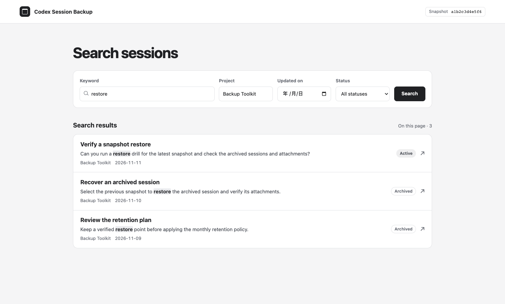

# Codex Session Backup

Back up, search, and restore local Codex chats on macOS. The CLI stores encrypted incremental snapshots in a private Tencent Cloud COS bucket using restic. A local browser interface lets you search active and archived chats.

[简体中文](https://github.com/WayneGongCN/codex-session-backup/blob/main/README.zh-CN.md) · [Project homepage](https://codex-session-backup.waynegong.com/) · [Release v0.1.1](https://github.com/WayneGongCN/codex-session-backup/releases/tag/v0.1.1)



## Quick start

Install the dependencies with Homebrew. The SQLite library bundled with Python must support FTS5 with the trigram tokenizer. GnuPG encrypts and decrypts the recovery package.

```sh
brew install python restic rclone zstd gnupg
python3 -c 'import sqlite3; sqlite3.connect(":memory:").execute("CREATE VIRTUAL TABLE fts_check USING fts5(text, tokenize=trigram)")'

git clone --depth 1 --branch v0.1.1 https://github.com/WayneGongCN/codex-session-backup.git
cd codex-session-backup
./codex-backup --help
```

You can also download **Source code (tar.gz)** from the release and run the same commands after extracting it. Keep the scripts and Python modules together. Use a stable installation path before enabling scheduled backups.

### Run a local recovery drill

```sh
python3 -m unittest -v
```

The test creates synthetic chats, a disposable restic repository, and a temporary password. It runs two backups, searches archived chats, restores an earlier snapshot, and checks repository integrity. It needs no cloud account, Keychain credentials, or real Codex chats.

### Back up to COS

Follow the [COS setup guide in Simplified Chinese](docs/usage.md#配置-cos-直连) to configure a private bucket, a scoped writer credential, and a GPG recovery package. Run `probe` for an existing repository or `init` for a new repository under an empty prefix. After your first backup, restore to an empty directory before enabling the LaunchAgent.

```sh
./codex-backup run
./codex-backup status
./codex-backup browse
./codex-backup restore --to /path/to/empty-restore
```

The tool covers local chats, archives, and supported attachment directories. Back up Git workspaces and external files separately. Account sign-in uses Codex's normal sign-in flow. See the [full usage guide](docs/usage.md) for recovery, scheduling, retention, and compatibility.

[MIT License](LICENSE)
