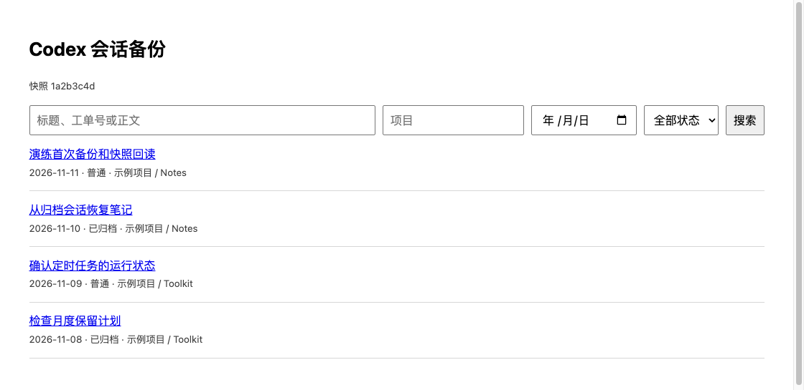

# Codex Session Backup

Encrypted incremental backup, local search, and verified restore for Codex chats on macOS. Store restic snapshots in a private Tencent Cloud COS bucket and browse active or archived chats from a local search page.

[使用指南](docs/usage.md) · [下载 v0.1.0](https://github.com/WayneGongCN/codex-session-backup/releases/tag/v0.1.0)



## 快速开始

在 macOS 上用 Homebrew 安装依赖。Python 的 SQLite 需要启用 FTS5 和 trigram 分词。GnuPG 用于生成和解密恢复包。

```sh
brew install python restic rclone zstd gnupg
python3 -c 'import sqlite3; sqlite3.connect(":memory:").execute("CREATE VIRTUAL TABLE fts_check USING fts5(text, tokenize=trigram)")'

git clone --depth 1 --branch v0.1.0 https://github.com/WayneGongCN/codex-session-backup.git
cd codex-session-backup
./codex-backup --help
```

也可以从 Release 下载 **Source code (tar.gz)**，解压后在目录中运行同样的命令。脚本和 Python 模块需要放在一起。如果要启用定时备份，请把目录放在稳定的位置。

### 本地演练

```sh
python3 -m unittest -v
```

测试自动生成合成会话、临时 restic 仓库和口令，演练两次备份、归档检索、历史快照恢复和完整性校验。测试使用临时目录，无需云账号、钥匙串凭据或真实 Codex 会话。

### 备份到 COS

按[使用指南](docs/usage.md#配置-cos-直连)配置私有桶、写入凭据和 GPG 恢复包。已有仓库运行 `probe`，空前缀首次接入运行 `init`。首次备份后先恢复到空目录，再启用定时任务。

```sh
./codex-backup run
./codex-backup status
./codex-backup browse
./codex-backup restore --to /path/to/empty-restore
```

工具备份本地会话、归档和受支持的附件目录。Git 工作区、外部文件与账号登录需要各自的恢复方式。详见[备份范围和兼容性](docs/usage.md#备份范围和兼容性)。

[MIT License](LICENSE)
