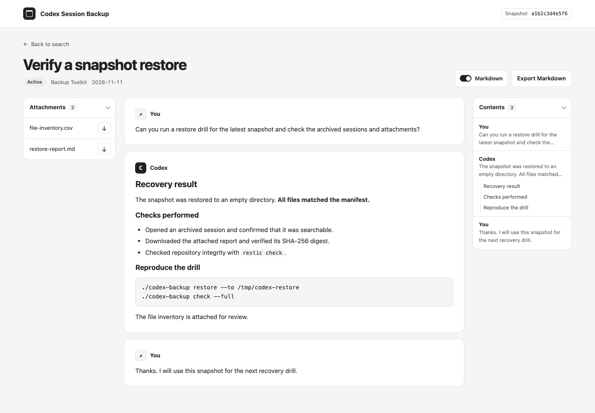

# Codex Session Backup

Back up, search, and restore local Codex chats on macOS. The CLI uses restic’s native S3 backend to store encrypted incremental snapshots in a private Tencent Cloud COS bucket. A local browser interface lets you search active and archived chats.

[简体中文](https://github.com/WayneGongCN/codex-session-backup/blob/main/README.zh-CN.md) · [Project homepage](https://codex-session-backup.waynegong.com/) · [Latest release](https://github.com/WayneGongCN/codex-session-backup/releases/latest)


## Quick start

Install the dependencies with Homebrew. The SQLite library bundled with Python must support FTS5 with the trigram tokenizer. GnuPG encrypts and decrypts the recovery package.

```sh
brew install python restic zstd gnupg
python3 -c 'import sqlite3; sqlite3.connect(":memory:").execute("CREATE VIRTUAL TABLE fts_check USING fts5(text, tokenize=trigram)")'

git clone --depth 1 https://github.com/WayneGongCN/codex-session-backup.git
cd codex-session-backup
./codex-backup --help
```

Keep the scripts, Python modules, and `search_assets/` together. Use a stable installation path before enabling scheduled backups.

### Run a local recovery drill

```sh
python3 -m unittest -v
```

The test uses synthetic chats, documents, and a disposable restic repository to exercise incremental backups, archived search, combined restores, and integrity checks.

### Back up to COS

Follow the [COS setup guide in Simplified Chinese](docs/usage.md#配置-cos-直连) to configure a private bucket, a scoped writer credential, and a GPG recovery package. Run `probe` for an existing repository or `init` for a new repository under an empty prefix. After your first backup, restore to an empty directory before enabling the LaunchAgent.

```sh
./codex-backup run
./codex-backup status
./codex-backup browse
./codex-backup restore --to /path/to/empty-restore
```

The session viewer renders Markdown by default. Use the Markdown switch to see the source, the contents panel to jump to messages and headings, and the attachments panel to download files from the snapshot.



The tool covers local chats, archives, and supported attachment directories. Set `documents_source` to include generated files in the same snapshot. Back up Git workspaces separately and use Codex's normal sign-in flow for account access. See the [usage guide](docs/usage.md#将产物纳入同一快照) for setup.

[MIT License](LICENSE)
